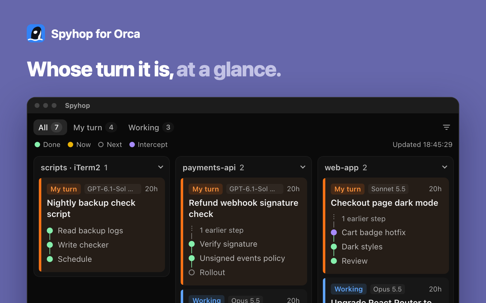

# Spyhop for Orca

Every AI coding session on one board, right in the Orca sidebar.
This plugin is the Orca view of [Spyhop](https://github.com/leeleelee3264/spyhop): it shows whose turn it is,
where each session is in its steps, its TODO and its last reply, without leaving Orca.



## Requirements

- macOS
- [Spyhop](https://github.com/leeleelee3264/spyhop) app **v2.1.4 or newer**, running on the same Mac.
  The plugin only draws; Spyhop finds and summarizes the sessions.
- Orca 1.4.246 or newer

## Install

```sh
orca plugin install leeleelee3264/spyhop-orca
```

The plugin runs code (it talks to Spyhop on `127.0.0.1:47613`), so Orca asks you to approve it once.
Open it from the right sidebar: **Spyhop**.

## What it does

- Board grouped by workspace or by AI topic, the same order as the Spyhop app
- Filter by My turn / Working, sort by newest or longest wait
- Each card shows the previous, current and next step; click it for the full detail
- Detail: steps, last reply, helpers, TODO you can tick, session ID copy
- Go to session, End session
- Drag a card to another column, including naming a new topic column
- Follows the Orca theme, with a few status color sets to choose from
- More columns as the panel gets wider

Back from the detail view: the Board button, Esc, the mouse back button, or a two-finger swipe.

## License

MIT
